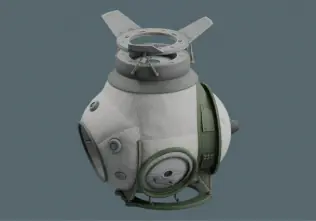
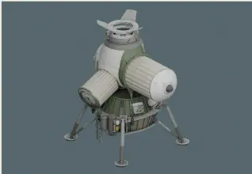

# Tantares Lunar Expansion

An unofficial expansion for Tantares in Kerbal Space Program 1.

My goal is to create a family of Soviet lunar spacecraft inspired by real historical designs and the alternate-history TV series *Star City*, while preserving the original Tantares style.

## Current development

- **LK-M (Modified)** — a single-crew lunar lander with an upper docking port attachment for Apollo-style internal crew transfer using FreeIVA. Version 0.2.2.
- **LK-R (Extended)** — a planned two-crew lunar lander with inflatable compartments for extended stays on the lunar surface. Currently in development.

This is an early work in progress, not a stable release.

## Screenshots

| LK-M — Modified lunar lander | LK-R — Extended lunar lander (WIP) |
| :---: | :---: |
|  |  |

*Development previews. LK-R is still in development and is not included in the current build.*

## Installation

Designed for KSP 1.12.5 with Tantares v28.0, FreeIVA and ModuleManager. Once the asset redistribution terms are confirmed, copy `GameData/TantaresLunarExpansion` into your KSP `GameData` directory. Craft files are not included.

## Credits and dependencies

- [Tantares](https://github.com/Tantares/Tantares) — original spacecraft models, textures and parts by Beale (Leo Semprini) and the Tantares contributors.
- [FreeIVA](https://github.com/FirstPersonKSP/FreeIva) — internal crew movement and hatch functionality by the FirstPersonKSP contributors.
- [ModuleManager](https://github.com/sarbian/ModuleManager) — configuration patching.

Many thanks to the original authors and contributors. This is an unofficial, independent fan project.

## License and asset provenance

See [LICENSE.md](LICENSE.md) and [third-party notices](Docs/THIRD-PARTY-NOTICES.md). The original assets remain subject to their respective upstream terms. Redistribution rights for modified Tantares assets have not yet been independently confirmed.
